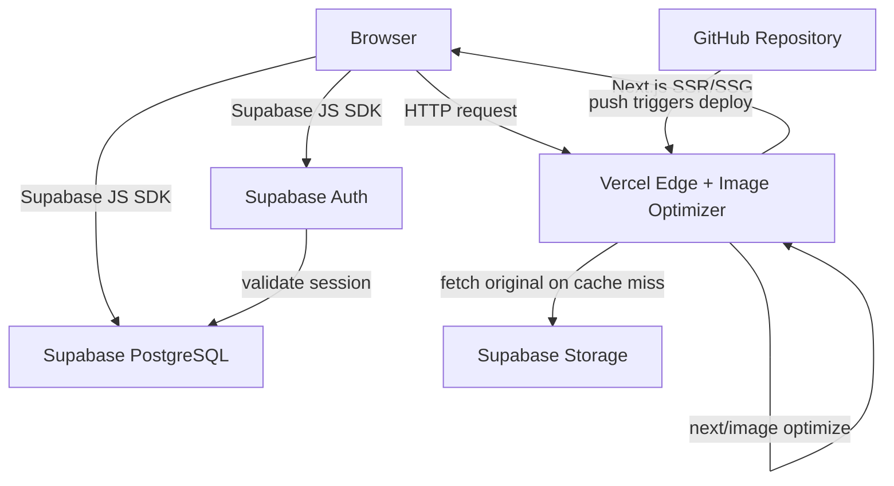
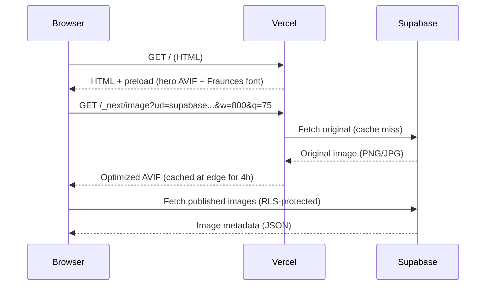
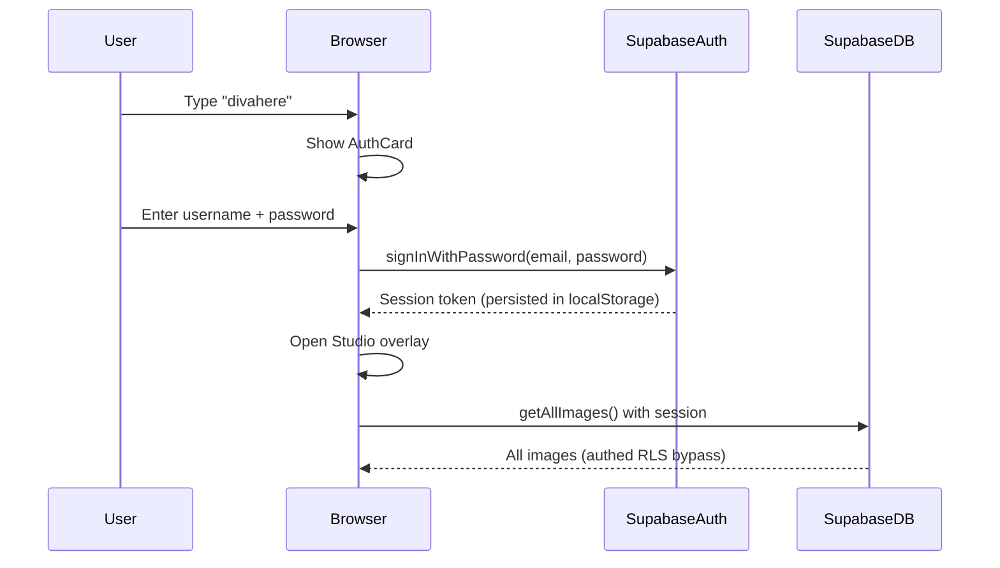

# Dhivakaran M — Portfolio

A cinematic designer portfolio built with Next.js 16, Supabase, and Vercel.

**Live site:** [dhivakaran-portfolio.vercel.app](https://dhivakaran-portfolio.vercel.app)

---

## Overview

A single-page portfolio for a graphic designer and video editor, featuring a
cinematic scroll experience, a Visual Lab canvas overlay, a secret admin Studio,
and an optimized image delivery pipeline with AVIF encoding and CDN caching.

The portfolio has two surfaces:

- **Public site** (`/`) — scroll-driven narrative with Hero, About, Selected Work,
  Video Section, Visual Lab, Skillset, and Contact.
- **Studio** (secret) — triggered by typing `divahere`, authenticated via Supabase
  Auth, provides full CRUD for categories, images, videos, and site settings.

---

## Technology Stack

| Layer | Technology |
|---|---|
| Framework | Next.js 16 (App Router, Turbopack) |
| Language | TypeScript 5 |
| Styling | Tailwind CSS 4 + shadcn/ui (New York) |
| Database | Supabase (PostgreSQL 15 + Row-Level Security) |
| Auth | Supabase Auth (email/password, session persistence) |
| Storage | Supabase Storage (S3-compatible public bucket) |
| State | TanStack React Query 5 (Studio only) |
| Smooth scroll | Lenis 1.3 |
| Drag-and-drop | @dnd-kit/core + @dnd-kit/sortable |
| Image optimization | next/image + Vercel Image Optimizer |
| Client compression | browser-image-compression (Web Worker) |
| Deployment | Vercel (Hobby plan) |

---

## Architecture



### Public request flow



### Studio authentication



---

## Database Schema

Four tables with Row-Level Security:

```
categories (id, name, slug, type, blurb, priority, created_at)
images (id, category_id, public_url, label, description, priority, published, in_lab, created_at)
videos (id, url, platform, label, description, priority, published, created_at)
site_settings (id=1, name, tagline, about, whatsapp, email, updated_at)
```

### RLS policies

| Table | Public (anon) | Authed (Studio) |
|---|---|---|
| categories | SELECT (all) | INSERT, UPDATE, DELETE |
| images | SELECT (WHERE published = true) | INSERT, UPDATE, DELETE |
| videos | SELECT (WHERE published = true) | INSERT, UPDATE, DELETE |
| site_settings | SELECT (all) | UPDATE |
| storage.objects | SELECT (bucket = portfolio) | INSERT, UPDATE, DELETE |

### Optional migrations (not yet applied)

| File | Adds | Effect if not applied |
|---|---|---|
| `supabase/migrations/add_lqip_data.sql` | `images.lqip_data TEXT` | No blur-up placeholder. Graceful fallback. |
| `supabase/migrations/add_process_media.sql` | `process_video_url`, `process_image_url`, `preview_order` on images + videos | No process media hover previews. Graceful fallback. |

All mutations have graceful fallbacks — if optional columns don't exist, they retry without them.

---

## Image Pipeline

### Upload (Studio)

```
File → browser-image-compression (max 800KB, 1920px, Web Worker)
     → generateLQIP (Canvas API, 16px base64 WebP, ~200 bytes)
     → Supabase Storage upload (cacheControl: '31536000' = 1 year)
     → Database INSERT (public_url + lqip_data + process media)
```

All upload paths route through a shared service: `src/lib/image-service.ts`.

### Delivery (public site)

```
next/image → Vercel Image Optimizer
  → Format: AVIF (10x smaller than PNG)
  → Responsive: srcset based on deviceSizes [400, 800, 1280, 1920]
  → CDN: cached at edge for 14400s (4h, Next.js default minimumCacheTTL)
  → Cache-Control: public, max-age=14400, must-revalidate
```

### Cache layers

```
Browser cache → Vercel edge cache (4h TTL) → Supabase Storage (origin)
```

New uploads get `Cache-Control: max-age=31536000` (1 year). The Vercel optimizer
uses `Math.max(minimumCacheTTL=14400, origin_max_age)` for the optimizer cache TTL.

---

## Studio Architecture

The Studio is a secret admin panel with a 3-pane layout:

```
┌──────────────────────────────────────────────────┐
│ Top bar: breadcrumb + Preview + Close            │
├──────────┬───────────────────────────────────────┤
│ Sidebar  │ Main content (scrollable)             │
│ - Frames │ - Cards with hover-revealed actions   │
│ - Lab    │ - Drag-drop reorder (@dnd-kit)        │
│ - Videos │ - Bulk ops (publish/hide/delete)      │
│ - Settings│ - DetailPanel (slides from right)    │
│ - Stats  │                                       │
├──────────┴───────────────────────────────────────┤
│ Status bar: counts + save status                 │
└──────────────────────────────────────────────────┘
```

**State management:** TanStack React Query 5, scoped to the Studio only (public site uses raw useEffect). Prefetch on Studio open → instant tab switching.

**Detail panel:** slides in from right when a card is clicked. Handles both upload (new image) and edit (existing image) modes.

---

## Frontend Component Organization

```
src/app/
  layout.tsx          — HTML shell, font preload, LCP image preload
  page.tsx            — single-page composition
  globals.css         — design system (colors, easings, @font-face, keyframes)

src/components/portfolio/
  hero.tsx            — spring-stagger name + parallax + cross-fade blur
  about.tsx           — WaveText scroll development
  selected-work.tsx   — next/image cells + hover card + MediaViewer
  video-section.tsx   — next/image thumbnails + descriptions
  visual-lab-card.tsx — 12-tile blurred glimpse
  visual-lab.tsx      — full-screen drag canvas (lazy-loaded)
  media-viewer.tsx    — slide-in-from-right viewer (lazy-loaded)
  studio/             — admin panel (lazy-loaded)
    studio-overlay.tsx
    studio-detail-panel.tsx
    selected-frames-tab.tsx
    lab-tab.tsx
    videos-tab.tsx
    site-settings-tab.tsx
  lib/                — hooks + helpers
    image-service.ts  — shared compression + upload + LQIP
    generate-lqip.ts  — Canvas API LQIP generator
    use-lenis.ts       — smooth scroll
    use-magnetic-cursor.ts — Apple-style cursor (dot + ring + glow)
```

---

## Environment Variables

Set in the Vercel project dashboard (Production environment):

| Name | Purpose |
|---|---|
| `NEXT_PUBLIC_SUPABASE_URL` | Supabase project URL (public, RLS-protected) |
| `NEXT_PUBLIC_SUPABASE_ANON_KEY` | Supabase anon key (public by design, RLS enforces access) |

No service role keys are used in the client code.

---

## Local Development

```bash
# Install dependencies
bun install

# Start dev server (port 3000)
bun run dev

# Lint
bun run lint

# Optimize local images (hero + about variants)
bun run scripts/optimize-images.ts

# Start the Studio (type "divahere" on the public site)
# Default username: diva
```

### Supabase setup

1. Create a Supabase project.
2. Run `supabase/schema.sql` in the SQL Editor.
3. Create a Storage bucket named `portfolio` (public).
4. Set environment variables in `.env.local`:
   ```
   NEXT_PUBLIC_SUPABASE_URL=your_project_url
   NEXT_PUBLIC_SUPABASE_ANON_KEY=your_anon_key
   ```
5. (Optional) Run `supabase/migrations/add_lqip_data.sql` + `add_process_media.sql` for LQIP + process media support.

---

## Deployment

```bash
# Deploy to Vercel production
vercel --prod

# Or push to GitHub (if Vercel-GitHub integration is configured)
git push origin main
```

The project is deployed on Vercel's Hobby plan. The Vercel Image Optimizer is
enabled by default (AVIF + WebP format negotiation, CDN edge caching).

---

## Security Considerations

- **RLS** — all tables have Row-Level Security. Public reads are limited to
  published content. Writes require authentication.
- **Storage** — public bucket with authed write policies. Public URLs are
  predictable (UUID-based) but not guessable.
- **Auth** — Supabase Auth with email/password. Session persisted in localStorage.
  The `divahere` keyboard trigger is a UX convenience, not a security boundary.
- **Environment variables** — only `NEXT_PUBLIC_` vars are exposed to the client.
  No service role keys are used in client code.
- **Upload validation** — client-side compression validates file size + dimensions.
  Compression failures are visible (never silently upload originals).

---

## Performance Decisions

| Decision | Rationale |
|---|---|
| AVIF + responsive srcset via next/image | 10x smaller than PNG, CDN-cached at edge |
| Self-hosted WOFF2 fonts (Latin subset) | Eliminates render-blocking Google Fonts CSS |
| content-visibility: auto on 7 sections | Skip paint for offscreen content |
| Pre-rendered blur (cross-fade) on Hero | No per-frame GPU convolution |
| Dynamic imports for Studio + Visual Lab | Admin UI not in initial bundle |
| React Query scoped to Studio | Public site carries no RQ overhead |
| browser-image-compression before upload | Max 800KB, 1920px, Web Worker |
| LQIP (16px base64 inline) | Instant blurred placeholder, zero HTTP requests |

---

## Known Limitations

1. **Existing Storage objects** — 17 images (90.6 MB total) were uploaded before
   the compression pipeline was implemented. They have `Cache-Control: private,
   no-cache` headers. Optimized replacements (5.2 MB total, 94% reduction) are
   prepared in `audit/storage-optimized/` but require Supabase write access to upload.
2. **Optional SQL migrations** — `lqip_data` and `process_media` columns are not
   applied. The code has graceful fallbacks, but LQIP blur-up placeholders and
   process media hover previews are not active until the migrations are run.
3. **Vercel Image Optimizer cache TTL** — uses the default 14400s (4 hours).
   Not explicitly configured. Adequate for current traffic.
4. **No automated tests** — the project relies on ESLint + manual verification.
5. **Prisma dependency** — still in `package.json` but unused (files removed).
   Can be safely removed via `bun remove @prisma/client prisma`.

---

## Future Engineering Opportunities

- Canvas2D migration for Visual Lab (eliminate DOM tile overhead)
- CV page overlay (glassmorphism + Apple-like spring animations)
- Service worker for offline image caching
- Server-side image pre-computation at upload time (Sharp on Vercel)
- Cmd+K command palette for the Studio

---

## Credits

Designed and built for **Dhivakaran M** — a designer working between brand,
product, and art direction.

Built with Next.js, Supabase, Vercel, Tailwind CSS, and shadcn/ui.
